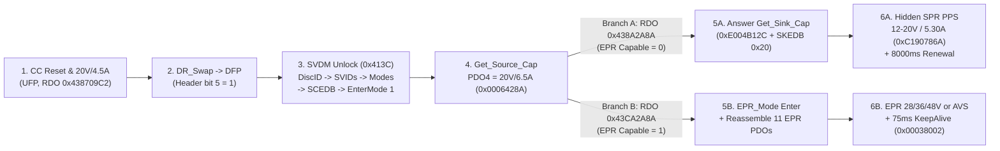

# Dell 280W (`LA280PM240`) USB-PD Proprietary Protocol

[Home](../../../README.md) / Dell LA280PM240 | [English](README.md) · [简体中文](README_CN.md)

Hardware-verified reverse-engineering specification of the USB Power Delivery (USB-PD 3.0 / 3.1 / 3.2) proprietary negotiation flow used by the **Dell 280W USB-C Power Adapter (`LA280PM240`, SVID `0x413C`)**.

Out of the box, the `LA280PM240` advertises standard USB-PD limits (`20V / 4.80A` = 96W in SPR, `28V / 36V / 48V @ 5.00A` and `15–48V 240W AVS` in EPR). Completing Dell's proprietary handshake sequence unlocks the adapter's full rated capabilities:

- **130W SPR Fixed**: `20.00V / 6.50A` (`0x0006428A`)
- **280W EPR Fixed**: `28.00V / 5.89A` (`0x0008C24D`), `36.00V / 5.83A` (`0x000B4247`), `48.00V / 5.83A` (`0x000F0247`, **279.84W**)
- **EPR AVS (255W)**: `15.00–48.00V`, PDP `255W` (`0xD3C096FF`, operating current capped at `min(5.00A, PDP / V)`)
- **Hidden SPR PPS (106W)**: `12.00–20.00V / 5.30A` (`0xC190786A`), broadcast only after answering `Get_Sink_Cap` with a PD 3.2 `SPR AVS Sink APDO` (`0xE004B12C`) and `Get_Sink_Cap_Extended` (`Sink Modes = 0x20`)

> [!WARNING]
> **High-Voltage Safety Notice**: This protocol controls up to **48V / 280W** over USB-C. Always disconnect unprotected downstream loads before testing `> 20V` transitions, always enter EPR at `5V` first when bringing up new implementations, and always negotiate back to `5V` before stopping `EPR_KeepAlive` or disconnecting.

---

## Capability Comparison: Standard PD vs. Dell Unlocked

| Mode / Capability | Standard PD (Locked / Before Dell SVDM) | Dell Proprietary Unlocked (`SVID 0x413C` Mode 1) |
|---|---|---|
| **SPR Fixed PDO1** | `5.00V / 3.00A` (`0x0A81912C`) | `5.00V / 3.00A` (`0x0A81912C`) |
| **SPR Fixed PDO2** | `9.00V / 3.00A` (`0x0002D12C`) | `9.00V / 3.00A` (`0x0002D12C`) |
| **SPR Fixed PDO3** | `15.00V / 3.00A` (`0x0004B12C`) | `15.00V / 3.00A` (`0x0004B12C`) |
| **SPR Fixed PDO4** | `20.00V / 4.80A` = 96W (`0x000641E0`) | **`20.00V / 6.50A` = 130W (`0x0006428A`)** |
| **SPR Hidden PDO5 (PPS)** | Not advertised | **`12.00–20.00V / 5.30A` = 106W (`0xC190786A`)** *(after Sink `0xE004B12C` + SKEDB `0x20`)* |
| **EPR Fixed PDO4** | `20.00V / 5.00A` (`0x000641F4`) | `20.00V / 5.00A` (`0x000641F4`) |
| **EPR Slots PDO5–7** | `0x00000000` (Empty) | `0x00000000` (Empty) |
| **EPR Fixed PDO8** | `28.00V / 5.00A` (140W) | **`28.00V / 5.89A` = 164.92W (`0x0008C24D`)** |
| **EPR Fixed PDO9 & PDO10** | `36.00V / 5.00A`, `48.00V / 5.00A` | **`36.00V / 5.83A` (`0x000B4247`)**, **`48.00V / 5.83A` (`0x000F0247`)** |
| **EPR AVS PDO11** | `15.0–48.0V`, PDP `240W` (`0xD3C096F0`) | **`15.0–48.0V`, PDP `255W` (`0xD3C096FF`)** |
| **SCEDB SPR PDP (offset 23)** | `0x64` (`100W`) | `0x6A` (`106W` = `20V × 5.30A`) |
| **SCEDB EPR PDP (offset 24)** | `0xF0` (`240W`) | `0xF0` (`240W`) |

### Nameplate `12V – 48V @ 5.3A` Explained

The `LA280PM240` nameplate prints `12V – 48V @ 5.3A`. At the USB-PD wire protocol level, that programmable range is split across two separate branches:

1. **SPR Branch (`12.00–20.00V / 5.30A`)**: Exposed as a **hidden SPR PPS APDO** (`0xC190786A`, 106W) only when an unlocked Sink advertises PD 3.2 `SPR AVS Sink APDO` (`0xE004B12C`) and `Sink Modes = 0x20` (AVS Support) in `Sink_Capabilities_Extended`.
2. **EPR Branch (`15.00–48.00V`)**: Exposed as **EPR AVS** (`0xD3C096FF`, PDP `255W` ≈ `48V × 5.31A`). Its minimum voltage floor is strictly enforced at **`15.00V`**, and PD 3.1 caps AVS operating current at `min(5.00A, PDP / V)`.

---

## High-Level Handshake Overview

---

## Documentation Index

| Document | English | 中文 | Description |
|---|---|---|---|
| **Protocol Flow** | [protocol-flow.md](protocol-flow.md) | [protocol-flow_CN.md](protocol-flow_CN.md) | Step-by-step handshake stages, Mermaid sequence diagrams, and both SPR PPS & 280W EPR branches |
| **Packet Reference** | [packet-reference.md](packet-reference.md) | [packet-reference_CN.md](packet-reference_CN.md) | Bit-level tables for PD headers, PDOs, RDOs, SVDM, SCEDB, SKEDB, Extended Control, and timing constraints |
| **Notes & Pitfalls** | [notes-and-pitfalls.md](notes-and-pitfalls.md) | [notes-and-pitfalls_CN.md](notes-and-pitfalls_CN.md) | Mandatory `DR_Swap`, KeepAlive `0x00038002` vs `0x00000000`, AVS limits, negative SVDM sweep results, and recovery |

---

## License

See [LICENSE](../../../LICENSE) ([CC BY 4.0](../../../LICENSE-CC-BY-4.0) for documentation, [MIT](../../../LICENSE-MIT) for code snippets and formulas).
