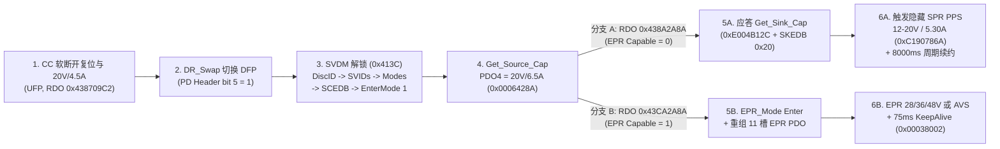

# Dell 280W (`LA280PM240`) USB-PD 私有诱骗协议

[首页](../../../README_CN.md) / Dell LA280PM240 | [English](README.md) · [简体中文](README_CN.md)

本专题记录 **Dell 280W USB-C 电源适配器（型号 `LA280PM240`，私有 SVID `0x413C`）** 经实机抓包与物理链路验证的完整 USB-PD 3.0 / 3.1 / 3.2 私有握手及诱骗协议规范。

在未进行私有握手的标准 PD 模式下，`LA280PM240` 仅开放受限功率档位（SPR 最高 `20V / 4.80A` = 96W，EPR 固定档上限 `5.00A`、AVS 上限 `240W`）。按规范完成 Dell 私有 SVDM 解锁与能力交互后，适配器会开放全部额定输出能力：

- **130W SPR 固定档**：`20.00V / 6.50A`（`0x0006428A`）
- **280W EPR 固定档**：`28.00V / 5.89A`（`0x0008C24D`）、`36.00V / 5.83A`（`0x000B4247`）、`48.00V / 5.83A`（`0x000F0247`，**279.84W**）
- **EPR AVS（255W）**：`15.00–48.00V`，PDP `255W`（`0xD3C096FF`，PD 3.1 规范限制请求电流上限为 `min(5.00A, PDP / V)`）
- **隐藏 SPR PPS（106W）**：`12.00–20.00V / 5.30A`（`0xC190786A`），需在 130W 解锁后应答适配器 `Get_Sink_Cap`（携带 PD 3.2 `SPR AVS Sink APDO` `0xE004B12C`）及 `Get_Sink_Cap_Extended`（`Sink Modes = 0x20`）方可触发广播

> [!WARNING]
> **高压安全提示**：本协议最高可输出 **48V / 280W** 直流高压大功率。测试 `> 20V` 档位前务必断开不耐压的下游负载；调试新实现时建议进入 EPR 后先停留在 `5V` 契约再切换高压；退出或断开前务必先将契约回落至 `5V`，再停止发送 `EPR_KeepAlive`。

---

## 标准 PD 与 Dell 私有解锁态能力对照表

| 模式 / 档位 | 标准 PD（未解锁 / 发送 Dell SVDM 前） | Dell 私有解锁态（`SVID 0x413C` Mode 1） |
|---|---|---|
| **SPR 固定档 PDO1** | `5.00V / 3.00A`（`0x0A81912C`） | `5.00V / 3.00A`（`0x0A81912C`） |
| **SPR 固定档 PDO2** | `9.00V / 3.00A`（`0x0002D12C`） | `9.00V / 3.00A`（`0x0002D12C`） |
| **SPR 固定档 PDO3** | `15.00V / 3.00A`（`0x0004B12C`） | `15.00V / 3.00A`（`0x0004B12C`） |
| **SPR 固定档 PDO4** | `20.00V / 4.80A` = 96W（`0x000641E0`） | **`20.00V / 6.50A` = 130W（`0x0006428A`）** |
| **SPR 隐藏档 PDO5（PPS）** | 不广播 | **`12.00–20.00V / 5.30A` = 106W（`0xC190786A`）** *（应答 `0xE004B12C` + SKEDB `0x20` 后触发）* |
| **EPR 固定档 PDO4** | `20.00V / 5.00A`（`0x000641F4`） | `20.00V / 5.00A`（`0x000641F4`） |
| **EPR 槽位 PDO5–7** | `0x00000000`（空槽） | `0x00000000`（空槽） |
| **EPR 固定档 PDO8** | `28.00V / 5.00A`（140W） | **`28.00V / 5.89A` = 164.92W（`0x0008C24D`）** |
| **EPR 固定档 PDO9 / PDO10** | `36.00V / 5.00A`、`48.00V / 5.00A` | **`36.00V / 5.83A`（`0x000B4247`）**、**`48.00V / 5.83A`（`0x000F0247`）** |
| **EPR AVS PDO11** | `15.0–48.0V`，PDP `240W`（`0xD3C096F0`） | **`15.0–48.0V`，PDP `255W`（`0xD3C096FF`）** |
| **SCEDB SPR PDP（偏移 23）** | `0x64`（`100W`） | `0x6A`（`106W` = `20V × 5.30A`） |
| **SCEDB EPR PDP（偏移 24）** | `0xF0`（`240W`） | `0xF0`（`240W`） |

### 铭牌「`12V – 48V @ 5.3A`」在 PD 协议中的真实映射

`LA280PM240` 铭牌标注了 `12V – 48V @ 5.3A`。在 USB-PD 协议层，这一宽范围可调输出被拆分为两条相互独立的分支：

1. **SPR 分支（`12.00–20.00V / 5.30A`）**：即隐藏的 **SPR PPS APDO**（`0xC190786A`，106W）。仅当 Sink 在解锁后向适配器应答包含 PD 3.2 `SPR AVS Sink APDO`（`0xE004B12C`）的 `Sink_Capabilities` 及开启 `Sink Modes = 0x20`（AVS Support）的 `Sink_Capabilities_Extended` 时才会重播出现。
2. **EPR 分支（`15.00–48.00V`）**：即 **EPR AVS**（`0xD3C096FF`，PDP `255W` ≈ `48V × 5.31A`）。EPR AVS 的最低电压底线在硬件中严格锁定为 **`15.00V`**，且请求电流受 PD 3.1 规范 `min(5.00A, PDP / V)` 包线限制。

---

## 全流程握手概览

---

## 文档目录

| 文档 | English | 简体中文 | 内容说明 |
|---|---|---|---|
| **完整诱骗流程** | [protocol-flow.md](protocol-flow.md) | [protocol-flow_CN.md](protocol-flow_CN.md) | 分阶段详细握手步骤、Mermaid 时序图、SPR 130W / 隐藏 PPS 与 280W EPR 两条完整分支 |
| **报文与编码参考** | [packet-reference.md](packet-reference.md) | [packet-reference_CN.md](packet-reference_CN.md) | PD Header 位域、PDO / RDO / SVDM / SCEDB / SKEDB / Extended Control 逐字节编码表与时序约束 |
| **实测避坑与经验总结** | [notes-and-pitfalls.md](notes-and-pitfalls.md) | [notes-and-pitfalls_CN.md](notes-and-pitfalls_CN.md) | `DR_Swap` 必要性、KeepAlive `0x00038002` 与 `0x00000000` 差异、AVS 底线实测、SVDM 穷举结论与静默恢复 |

---

## 开源许可

请参阅 [LICENSE](../../../LICENSE)（文档采用 [CC BY 4.0](../../../LICENSE-CC-BY-4.0)，代码片段与公式采用 [MIT](../../../LICENSE-MIT)）。
