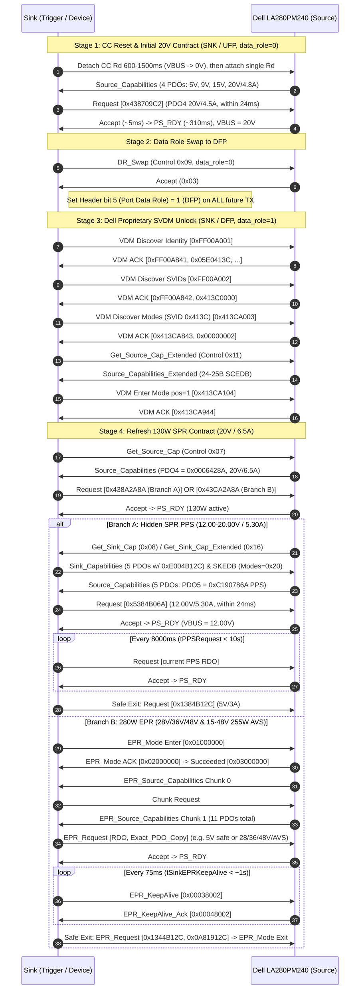

# Dell 280W (`LA280PM240`) Complete Protocol Flow

[Home](../../../README.md) / [Dell LA280PM240](README.md) | [English](protocol-flow.md) · [简体中文](protocol-flow_CN.md)

This document specifies the complete, hardware-verified USB-PD negotiation sequence for the **Dell 280W (`LA280PM240`)** power adapter from initial CC attachment through **130W SPR**, **Hidden SPR PPS (`12.00–20.00V / 5.30A`)**, and **280W EPR (`28V / 36V / 48V` & `15–48V 255W AVS`)**.

All multi-byte integers and 32-bit PD data objects are transmitted **little-endian** on the wire, shown here as standard 32-bit hexadecimal values (`0xXXXXXXXX`). Unless noted otherwise, `Power Role = 0` (`Sink`) and `Spec Rev = 2` (`PD 3.0`) on all Sink TX frames.

---

## Sequence Diagram Overview



---

## Common Unlock Sequence (Stages 1–4)

### Stage 1: Port Reset & Initial 20V Contract (`SNK / UFP`, `power_role=0, data_role=0`)

1. **Soft CC Detach Reset**
   - Remove CC `Rd` pull-down for **`600ms–1500ms`** until `VBUS` discharges completely to `0V`.
   - Re-attach single-channel `Rd` (matching the active CC polarity) and enable hardware automatic `GoodCRC` (`PD 3.0`, `Spec Rev = 2`).
   - Why: If an earlier negotiation failed or stalled, the adapter latches into PD silence; a clean CC detach reset brings back initial `Source_Capabilities`.

2. **Receive Initial `Source_Capabilities`** (`SRC -> SNK`, Data `type=0x01`, `count=4`)
   - `PDO1`: `0x0A81912C` — Fixed `5.00V / 3.00A` (flags: Unconstrained Power, Dual-Role Data, EPR Mode Capable)
   - `PDO2`: `0x0002D12C` — Fixed `9.00V / 3.00A`
   - `PDO3`: `0x0004B12C` — Fixed `15.00V / 3.00A`
   - `PDO4`: `0x000641E0` — Fixed `20.00V / 4.80A` (96.00W standard limit)

3. **Request Initial 20V / 4.50A Contract** (`~5ms` after `Source_Capabilities`, strictly `< 24ms` `tSenderResponse`)
   - **TX**: Data `type=0x02` (`Request`), `count=1`, `power_role=0`, `data_role=0`
   - **Payload**: `[0x438709C2]`
     - `pos = 4` (`20V`), Flags `0x03800000` (USB Comm, No USB Suspend, Unchunked Extended Messages Supported; `EPR Mode Capable` bit 22 = `0`), Operating & Max Current = `4500mA` (`450 × 10mA`).
   - **RX**: Wait for `Accept` (Control `type=0x03`, `~5ms`) followed by `PS_RDY` (Control `type=0x06`, `~310ms`). `VBUS` transitions to `20.0V`.

---

### Stage 2: Data Role Swap to DFP

4. **Initiate `DR_Swap`** (`~6ms` after initial `PS_RDY`)
   - **TX**: Control `type=0x09` (`DR_Swap`), `count=0`, `power_role=0`, `data_role=0`
   - **RX**: Wait for `Accept` (Control `type=0x03`).
   - **State Update**: Set PD Header **`bit 5 (Port Data Role) = 1 (DFP)`** for **every subsequent transmitted packet**.
   - **Why this is mandatory**: Standard PD sinks start as UFP (`data_role=0`), whereas Structured VDM initiators must be DFP (`data_role=1`) in PD 3.0. Without swapping to DFP, the adapter will not accept the unlock VDM sequence.

---

### Stage 3: Dell Proprietary SVDM Unlock (`SNK / DFP`, `power_role=0, data_role=1`)

All VDM packets below use Data `type=0x0F` (`VDM`), `count=1`, `data_role=1`.

5. **`Discover Identity`** (`~40ms` after `DR_Swap` `Accept`)
   - **TX**: `[0xFF00A001]` (Standard Discovery SVID `0xFF00`, Structured VDM v2.0, `REQ`, cmd `0x01`)
   - **RX**: VDM `ACK` `[0xFF00A841, 0x05E0413C, ...]` — confirms Dell USB VID `0x413C` in ID Header VDO bits `15:0`.
   - *(Note: In captured workstation sessions, the adapter may also send a `Discover Identity` request toward the sink; when the sink initiates after `DR_Swap`, verify `0x413C` in the ACK.)*

6. **`Discover SVIDs`** (`~295ms` after `Discover Identity` `ACK`)
   - **TX**: `[0xFF00A002]`
   - **RX**: VDM `ACK` `[0xFF00A842, 0x413C0000]` — confirms proprietary SVID `0x413C`.

7. **`Discover Modes`** (`~6ms` after `Discover SVIDs` `ACK`)
   - **TX**: `[0x413CA003]` (SVID `0x413C`, cmd `0x03`)
   - **RX**: VDM `ACK` `[0x413CA843, 0x00000002]` — Mode 1 VDO = `0x00000002`.

8. **`Get_Source_Cap_Extended`** (`~11ms` after `Discover Modes` `ACK`)
   - **TX**: Control `type=0x11` (`Get_Source_Cap_Extended`), `count=0`, `data_role=1`
   - **RX**: Extended `ext=1, type=0x01` (`Source_Capabilities_Extended`, 24–25 bytes SCEDB).

9. **`Enter Mode` (Position 1)** (`~31ms` after `SCEDB`)
   - **TX**: `[0x413CA104]` (SVID `0x413C`, `position=1`, `REQ`, cmd `0x04`)
   - **RX**: VDM `ACK` `[0x413CA944]` — Dell proprietary mode unlocked.

---

### Stage 4: Refresh Source Capabilities to 130W (`20V / 6.50A`)

10. **Query Refreshed `Source_Capabilities`** (`~35ms` after `Enter Mode` `ACK`)
    - **TX**: Control `type=0x07` (`Get_Source_Cap`), `count=0`, `data_role=1`
    - **RX**: Data `type=0x01` (`Source_Capabilities`), `count=4`. `PDO4` is now upgraded to **`0x0006428A`** (`Fixed 20.00V / 6.50A` = **130W**).

11. **Request Unlocked 20V / 6.50A Contract** (`~5ms` after refreshed `Source_Capabilities`, `< 24ms`)
    - Choose the RDO based on which branch you want next:
      - **For Branch A (SPR 130W & Hidden PPS `12–20V / 5.30A`)**:
        - **TX**: Data `type=0x02` (`Request`), `count=1`, `data_role=1`, Payload = `[0x438A2A8A]` (`pos=4`, Flags `0x03800000`, `EPR Mode Capable = 0`, `6500mA`).
      - **For Branch B (280W EPR `28V / 36V / 48V` & `15–48V 255W AVS`)**:
        - **TX**: Data `type=0x02` (`Request`), `count=1`, `data_role=1`, Payload = `[0x43CA2A8A]` (`pos=4`, Flags `0x03C00000`, **`EPR Mode Capable` bit 22 = `1`**, `6500mA`).
    - **RX**: Wait for `Accept` (`0x03`) → `PS_RDY` (`0x06`, `~310ms`). The **130W** SPR contract is now active.

---

## Branch A: Trigger Hidden SPR PPS (`12.00–20.00V / 5.30A`)

> Use this branch when you want **12.00V – 20.00V at up to 5.30A (106W)**. Note that EPR AVS cannot drop below `15.00V`; this hidden SPR PPS profile is the **only** way to obtain `12.00V – 14.98V` from the `LA280PM240` over USB-PD.

### Stage 5A: Answer Adapter Sink Capability Queries

12. **Passively Respond to `Get_Sink_Cap` / `Get_Sink_Cap_Extended`**
    - When the adapter sends **`Get_Sink_Cap`** (Control `type=0x08`, `count=0`), reply immediately with **`Sink_Capabilities`** (Data `type=0x04`, `count=5`, `data_role=1`), including a PD 3.2 **`SPR AVS Sink APDO`** at PDO5:
      ```text
      0x0001912C  # PDO1: Fixed 5.00V / 3.00A
      0x0002D12C  # PDO2: Fixed 9.00V / 3.00A
      0x0004B12C  # PDO3: Fixed 15.00V / 3.00A
      0x0006412C  # PDO4: Fixed 20.00V / 3.00A
      0xE004B12C  # PDO5: PD 3.2 SPR AVS Sink APDO (9-15V @ 3.00A, 15-20V @ 3.00A)
      ```
    - When the adapter sends **`Get_Sink_Cap_Extended`** (Control `type=0x16`, `count=0`), reply immediately with **`Sink_Capabilities_Extended`** (Extended `ext=1, type=0x0F`, `count=7`, `data_role=1`), carrying unchunked extended header `0x0018` (`24` bytes SKEDB) with `Sink Modes` byte 17 = `0x20` (`AVS Support` bit 5 set):
      ```text
      0x00000018  0x00000000  0x00000000  0x00000001
      0x20000000  0x003C2805  0x00000000
      ```
      *(Note: SKEDB bytes `0..3` carry `VID / PID`, shown here as `0x0000 / 0x0000` placeholders — populate with your own Sink VID/PID as needed; `Sink Modes = 0x20` at byte offset 17 is the functional AVS support trigger.)*

13. **Receive 5-PDO `Source_Capabilities` with Hidden PPS & Acknowledge Within `24ms`**
    - **RX**: The adapter re-broadcasts `Source_Capabilities` (Data `type=0x01`, `count=5`):
      - `PDO1`: `0x0A81912C` — Fixed `5.00V / 3.00A`
      - `PDO2`: `0x0002D12C` — Fixed `9.00V / 3.00A`
      - `PDO3`: `0x0004B12C` — Fixed `15.00V / 3.00A`
      - `PDO4`: `0x0006428A` — Fixed `20.00V / 6.50A`
      - `PDO5`: **`0xC190786A`** — **SPR PPS `12.00V–20.00V / 5.30A`** (106W)
    - **TX**: Send a `Request` within **`24ms`** — either jump straight to Step 14 for PPS, or request a fixed contract (`[0x438A2A8A]` for `20V / 6.5A` or `[0x1384B12C]` for `5V / 3A`) to keep the link active.

### Stage 6A: Request PPS Voltage, Renewal & Safe Exit

14. **Send SPR PPS `Request`**
    - **TX**: Data `type=0x02` (`Request`), `count=1`, `data_role=1`
    - **RDO Encoding** (`pos = 5`, voltage in `20mV` steps `12000–20000mV`, current in `50mA` steps `50–5300mA`):
      ```c
      uint32_t pps_rdo(uint32_t mv, uint32_t ma) {
          return (5u << 28) | 0x03800000u | ((mv / 20u) << 9) | (ma / 50u);
      }
      ```
      - `12.00V / 5.30A`: `0x5384B06A`
      - `12.00V / 3.00A`: `0x5384B03C`
      - `16.00V / 5.00A`: `0x53864064`
    - **RX**: Wait for `Accept` (`0x03`) → `PS_RDY` (`0x06`). `VBUS` settles at the requested PPS voltage.

15. **Periodic PPS Renewal (`tPPSRequest`)**
    - While holding an active PPS contract, resend the current PPS `Request` every **`8000ms`** (strictly `< 10s` per USB-PD spec) and consume `Accept` → `PS_RDY`.

16. **Safe Drop-Back Exit**
    - **TX**: Send Fixed `5V / 3.00A` `Request` (`type=0x02`, `count=1`, `data_role=1`), Payload = `[0x1384B12C]` (`pos=1`, `3000mA`).
    - **RX**: Wait for `Accept` (`0x03`) → `PS_RDY` (`0x06`), confirm `VBUS ≈ 5.0V`, then stop PPS renewal.

---

## Branch B: Enter 280W EPR (`28V / 36V / 48V` & `15–48V 255W AVS`)

> Prerequisite: Step 11 must have requested 130W with **`EPR Mode Capable` (bit 22) = `1`** (`0x43CA2A8A`).

### Stage 5B: Enter EPR Mode & Reassemble 11-Slot `EPR_Source_Capabilities`

12. **Send `EPR_Mode` Enter** (`~30ms` after 130W `PS_RDY`, `data_role=1`)
    - **TX**: Data `type=0x0A` (`EPR_Mode`), `count=1`, `data_role=1`, Payload = `[0x01000000]` (`Action = 0x01 Enter`)
    - **RX**:
      - `EPR_Mode` `0x02000000` (`Action = 0x02 Enter Acknowledged`)
      - `EPR_Mode` `0x03000000` (`Action = 0x03 Enter Succeeded`)

13. **Receive Chunked `EPR_Source_Capabilities`** (Extended `ext=1, type=0x11`)
    - **RX**: `EPR_Source_Capabilities` Chunk 0 (extended header indicates total `44` bytes = 11 × 32-bit PDOs; first 26 bytes delivered in Chunk 0).
    - **TX**: Request Chunk 1 — Extended `ext=1, count=1, type=0x11`, `data_role=1`, Payload = **`[0x00008C00]`**
      - Extended header `0x8C00`: `Chunked=1`, `Chunk Number=1`, `Request Chunk=1`, `Data Size=0`.
    - **RX**: `EPR_Source_Capabilities` Chunk 1 → reassemble all `44` bytes into **11 PDO slots**:
      - `PDO1`: `0x0A81912C` — Fixed `5.00V / 3.00A`
      - `PDO2`: `0x0002D12C` — Fixed `9.00V / 3.00A`
      - `PDO3`: `0x0004B12C` — Fixed `15.00V / 3.00A`
      - `PDO4`: `0x000641F4` — Fixed `20.00V / 5.00A` (100W in EPR mode)
      - `PDO5–7`: `0x00000000` — Empty SPR slots
      - `PDO8`: **`0x0008C24D`** — Fixed `28.00V / 5.89A` (`164.92W`)
      - `PDO9`: **`0x000B4247`** — Fixed `36.00V / 5.83A` (`209.88W`)
      - `PDO10`: **`0x000F0247`** — Fixed `48.00V / 5.83A` (`279.84W`)
      - `PDO11`: **`0xD3C096FF`** — **EPR AVS `15.00–48.00V`, PDP `255W`**

### Stage 6B: Request EPR Fixed / AVS, KeepAlive & Safe Exit

14. **Send `EPR_Request`**
    - **TX**: Data `type=0x09` (`EPR_Request`), `count=2`, `data_role=1`
    - **Payload (always 2 objects)**: `[RDO, Exact_Copy_of_Advertised_PDO]`
    - **Option 1 — Fixed EPR RDO** (`flags = 0x03400000`: USB Comm, No Suspend, Unchunked=0, EPR Mode Capable=1):
      ```c
      uint32_t epr_fixed_rdo(uint8_t pos, uint32_t ma) {
          uint32_t i10 = ma / 10u;
          return ((uint32_t)pos << 28) | 0x03400000u | (i10 << 10) | i10;
      }
      ```
      - Safe `5.00V / 3.00A` (`pos=1`): `[0x1344B12C, 0x0A81912C]` *(recommended initial landing state after entering EPR)*
      - `28.00V / 5.89A` (`pos=8`): `[0x8349364D, 0x0008C24D]`
      - `36.00V / 5.83A` (`pos=9`): `[0x93491E47, 0x000B4247]`
      - `48.00V / 5.83A` (`pos=10`): `[0xA3491E47, 0x000F0247]`
    - **Option 2 — EPR AVS RDO** (`pos=11`, voltage in `25mV` steps `15000–48000mV`, current in `50mA` steps, PDO copy = `0xD3C096FF`):
      ```c
      uint32_t epr_avs_rdo(uint32_t mv, uint32_t ma) {
          return (11u << 28) | 0x03C00000u | ((mv / 25u) << 9) | (ma / 50u);
      }
      ```
      - **Mandatory Operating Current Envelope**:
        `I_mA <= min(5000, floor_50mA(PDP_W * 1,000,000 / V_mV))`
        Requests below `15.00V` or above `5.00A` are strictly rejected (`Reject` `0x04`).
      - Verified examples:
        - `15.00V / 5.00A`: `[0xB3C4B064, 0xD3C096FF]`
        - `20.00V / 5.00A`: `[0xB3C64064, 0xD3C096FF]`
        - `48.00V / 5.00A`: `[0xB3CF0064, 0xD3C096FF]`
    - **RX**: Wait for `Accept` (`0x03`) → `PS_RDY` (`0x06`, `~710ms` for high-voltage step-up).

15. **EPR KeepAlive (`tSinkEPRKeepAlive`)**
    - While EPR mode is active, send an Extended Control `EPR_KeepAlive` every **`75ms`** (adapter drops EPR and resets to 5V after `~1s` without valid KeepAlive):
      - **TX**: Extended `ext=1, count=1, type=0x10` (`Extended_Control`), `data_role=1`, Payload = **`[0x00038002]`**
        - Extended Header `0x8002` (`Chunked=1, Data Size=2`) + ECDB Type `0x03` (`EPR_KeepAlive`) + Data `0x00`.
      - **RX**: Extended `ext=1, type=0x10`, Payload = **`[0x00048002]`** (`ECDB Type 0x04 = EPR_KeepAlive_Ack`).
    - *(During an active `EPR_Request -> Accept -> PS_RDY` voltage transition, pause KeepAlive until `PS_RDY` completes, then resume every `75ms`.)*

16. **Safe Exit from EPR**
    - **Step 1**: Send `EPR_Request` for `5.00V / 3.00A` (`[0x1344B12C, 0x0A81912C]`) → wait for `Accept` → `PS_RDY` and confirm `VBUS ≈ 5.0V`.
    - **Step 2 (Optional clean teardown)**: Send `EPR_Mode` Exit (`type=0x0A, count=1`, `[0x05000000]`), wait for SPR `Source_Capabilities`, request SPR `5.00V / 3.00A` (`[0x1384B12C]`) → `Accept` → `PS_RDY`, and then stop `EPR_KeepAlive`.
