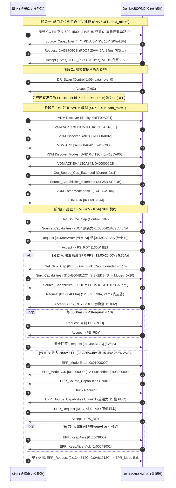

# Dell 280W (`LA280PM240`) 完整诱骗协议流程

[首页](../../../README_CN.md) / [Dell LA280PM240](README_CN.md) | [English](protocol-flow.md) · [简体中文](protocol-flow_CN.md)

本文档完整描述 **Dell 280W（`LA280PM240`）** 电源适配器从端口复位建链到 **130W SPR**、**隐藏 SPR PPS（`12.00–20.00V / 5.30A`）** 以及 **280W EPR（`28V / 36V / 48V` 与 `15–48V 255W AVS`）** 的全部硬件实测握手流程。

USB-PD 线缆上所有多字节整数与 32-bit 数据对象均按**小端序（Little-Endian）**传输，本文均以标准 32-bit 十六进制字（`0xXXXXXXXX`）展示。除特别说明外，Sink 端发送的报文头默认 `Power Role = 0`（Sink）、`Spec Rev = 2`（PD 3.0）。

---

## 全流程时序图



---

## 公共解锁序列（阶段一至阶段四）

### 阶段一：端口复位与初始 20V 建链（`SNK / UFP`，`power_role=0, data_role=0`）

1. **CC 软断开复位**
   - 断开 CC 引脚 `Rd` 下拉并维持 **`600ms–1500ms`**，待 `VBUS` 完全跌落归零后再重新挂载单路 `Rd`（对应当前导通的 CC 通道），同时开启硬件自动 `GoodCRC`（PD 3.0，`Spec Rev = 2`）。
   - 说明：若上一轮协商中途失败或出现异常报文，适配器会进入 PD 静默状态；完整的 CC 断连复位可稳定恢复初始广播。

2. **接收初始 `Source_Capabilities`**（`SRC -> SNK`，Data `type=0x01`，`count=4`）
   - `PDO1`：`0x0A81912C` — Fixed `5.00V / 3.00A`（带 Unconstrained Power、Dual-Role Data、EPR Mode Capable 标志）
   - `PDO2`：`0x0002D12C` — Fixed `9.00V / 3.00A`
   - `PDO3`：`0x0004B12C` — Fixed `15.00V / 3.00A`
   - `PDO4`：`0x000641E0` — Fixed `20.00V / 4.80A`（未解锁标准态上限 96.00W）

3. **请求初始 20V / 4.50A 契约**（收到 Caps 后约 `5ms` 内发出，不得超过 `24ms` `tSenderResponse`）
   - **TX**：Data `type=0x02` (`Request`)，`count=1`，`power_role=0`，`data_role=0`
   - **Payload**：`[0x438709C2]`
     - `pos = 4`（`20V`），Flags `0x03800000`（USB Comm、No Suspend、Unchunked Extended Messages Supported，暂不置位 EPR Bit 22），工作电流与最大电流均设为 `4500mA`（`450 × 10mA`）。
   - **RX**：等待 `Accept`（Control `type=0x03`，约 `5ms`）→ `PS_RDY`（Control `type=0x06`，约 `310ms`），`VBUS` 升压至 `20.0V`。

---

### 阶段二：切换数据角色为 DFP

4. **发起 `DR_Swap`**（初始 `PS_RDY` 后延迟约 `6ms`）
   - **TX**：Control `type=0x09` (`DR_Swap`)，`count=0`，`power_role=0`，`data_role=0`
   - **RX**：等待 `Accept`（Control `type=0x03`）。
   - **状态更新**：收到 `Accept` 后，将本地后续**所有发包的 PD Header `bit 5 (Port Data Role)` 置为 `1 (DFP)`**。
   - **关键必要性**：PD 3.0 默认 Sink 为 UFP（`data_role=0`），只有切换为 DFP（`data_role=1`）后发起 Structured VDM 探测，适配器才会受理后续 Dell 私有解锁流程。

---

### 阶段三：Dell 私有 SVDM 解锁（`SNK / DFP`，`power_role=0, data_role=1`）

以下 VDM 报文均使用 Data `type=0x0F` (`VDM`)、`count=1`、`data_role=1`。

5. **`Discover Identity`**（`DR_Swap` `Accept` 后延迟约 `40ms`）
   - **TX**：`[0xFF00A001]`（Discovery SVID `0xFF00`，SVDM v2.0，`REQ`，命令 `0x01`）
   - **RX**：VDM `ACK` `[0xFF00A841, 0x05E0413C, ...]` — 确认返回 VID `0x413C`。
   - *（注：实机工作站连接时，适配器也可能先主动向 Sink 查询 `Discover Identity`；作为触发方在 `DR_Swap` 后主动查询并核对 `0x413C` 即可。）*

6. **`Discover SVIDs`**（Identity `ACK` 后延迟约 `295ms`）
   - **TX**：`[0xFF00A002]`
   - **RX**：VDM `ACK` `[0xFF00A842, 0x413C0000]` — 获取私有 SVID `0x413C`。

7. **`Discover Modes`**（SVIDs `ACK` 后延迟约 `6ms`）
   - **TX**：`[0x413CA003]`（SVID `0x413C`，命令 `0x03`）
   - **RX**：VDM `ACK` `[0x413CA843, 0x00000002]` — Mode 1 VDO 为 `0x00000002`。

8. **`Get_Source_Cap_Extended`**（Modes `ACK` 后延迟约 `11ms`）
   - **TX**：Control `type=0x11` (`Get_Source_Cap_Extended`)，`count=0`，`data_role=1`
   - **RX**：Extended `ext=1, type=0x01` (`Source_Capabilities_Extended`，24–25 字节 SCEDB）。

9. **`Enter Mode` 解锁模式 1**（收到 SCEDB 后延迟约 `31ms`）
   - **TX**：`[0x413CA104]`（SVID `0x413C`，`position=1`，`REQ`，命令 `0x04`）
   - **RX**：VDM `ACK` `[0x413CA944]` — 成功进入 Dell 私有解锁模式。

---

### 阶段四：刷新并建立 130W（`20V / 6.50A`）SPR 契约

10. **查询刷新后的供电能力**（`Enter Mode` `ACK` 后延迟约 `35ms`）
    - **TX**：Control `type=0x07` (`Get_Source_Cap`)，`count=0`，`data_role=1`
    - **RX**：Data `type=0x01` (`Source_Capabilities`)，`count=4`，其中 `PDO4` 刷新为 **`0x0006428A`**（`Fixed 20.00V / 6.50A` = **130W**）。

11. **请求解锁后的 20V / 6.50A 契约**（收到新 Caps 后约 `5ms` 内，不超过 `24ms`）
    - 根据接下来的目标分支选择对应 RDO：
      - **走分支 A（维持 SPR 130W 并触发隐藏 PPS `12–20V / 5.30A`）**：
        - **TX**：Data `type=0x02` (`Request`)，`count=1`，`data_role=1`，Payload = `[0x438A2A8A]`（`pos=4`，Flags `0x03800000`，`EPR Mode Capable` bit 22 = `0`，`6500mA`）。
      - **走分支 B（进入 280W EPR 拿 `28V / 36V / 48V` 与 `15–48V AVS`）**：
        - **TX**：Data `type=0x02` (`Request`)，`count=1`，`data_role=1`，Payload = `[0x43CA2A8A]`（`pos=4`，Flags `0x03C00000`，**置位 `EPR Mode Capable` bit 22 = `1`**，`6500mA`）。
    - **RX**：等待 `Accept`（`0x03`）→ `PS_RDY`（`0x06`，约 `310ms`），130W SPR 契约生效。

---

## 分支 A：触发隐藏 SPR PPS 档（`12.00–20.00V / 5.30A`）

> 若需要 **`12.00V – 20.00V` 最高 `5.30A`（106W）** 输出，必须走本分支。EPR AVS 最低只支持到 `15.00V`，因此隐藏 SPR PPS 是获得 `12.00V – 14.98V` 的唯一标准 PD 途径。

### 阶段 5A：应答 Sink 能力查询，触发广播隐藏 PPS 档

12. **被动应答适配器的 `Get_Sink_Cap` 与 `Get_Sink_Cap_Extended`**
    - 当收到适配器发来的 **`Get_Sink_Cap`**（Control `type=0x08`，`count=0`）时，立即回复 **`Sink_Capabilities`**（Data `type=0x04`，`count=5`，`data_role=1`），第 5 项声明 PD 3.2 **`SPR AVS Sink APDO`**：
      ```text
      0x0001912C  # PDO1: Fixed 5.00V / 3.00A
      0x0002D12C  # PDO2: Fixed 9.00V / 3.00A
      0x0004B12C  # PDO3: Fixed 15.00V / 3.00A
      0x0006412C  # PDO4: Fixed 20.00V / 3.00A
      0xE004B12C  # PDO5: PD 3.2 SPR AVS Sink APDO (9-15V @ 3.00A, 15-20V @ 3.00A)
      ```
    - 当收到适配器发来的 **`Get_Sink_Cap_Extended`**（Control `type=0x16`，`count=0`）时，立即回复 **`Sink_Capabilities_Extended`**（Extended `ext=1, type=0x0F`，`count=7`，`data_role=1`），包含非分片扩展头 `0x0018`（24 字节 SKEDB），其中字节偏移 `17` 置位 **`Sink Modes = 0x20`（bit 5 AVS Support）**：
      ```text
      0x00000018  0x00000000  0x00000000  0x00000001
      0x20000000  0x003C2805  0x00000000
      ```
      *（注：SKEDB 字节 `0..3` 为 `VID / PID` 字段，此处以 `0x0000 / 0x0000` 占位，实际使用时可按需填入自有 Sink VID/PID；真正起触发作用的是字节 17 的 `Sink Modes = 0x20`。）*

13. **接收含隐藏 PPS 档的 5 项 `Source_Capabilities` 并在 `24ms` 内应答**
    - **RX**：适配器主动重播 5 个 PDO 的 `Source_Capabilities`（Data `type=0x01`，`count=5`）：
      - `PDO1`：`0x0A81912C` — Fixed `5.00V / 3.00A`
      - `PDO2`：`0x0002D12C` — Fixed `9.00V / 3.00A`
      - `PDO3`：`0x0004B12C` — Fixed `15.00V / 3.00A`
      - `PDO4`：`0x0006428A` — Fixed `20.00V / 6.50A`
      - `PDO5`：**`0xC190786A`** — **SPR PPS `12.00V–20.00V / 5.30A`**（106W）
    - **TX**：在 **`24ms`** 内回复一次 `Request`（可直接按步骤 14 请求目标 PPS，或先请求 `[0x438A2A8A]` 维持 20V/6.5A / `[0x1384B12C]` 回落 5V 保持链路）。

### 阶段 6A：请求 PPS 调压、周期保活与安全退出

14. **发送 SPR PPS 调压请求**
    - **TX**：Data `type=0x02` (`Request`)，`count=1`，`data_role=1`
    - **RDO 编码**（`pos = 5`，电压步进 `20mV` 范围 `12000–20000mV`，电流步进 `50mA` 范围 `50–5300mA`）：
      ```c
      uint32_t pps_rdo(uint32_t mv, uint32_t ma) {
          return (5u << 28) | 0x03800000u | ((mv / 20u) << 9) | (ma / 50u);
      }
      ```
      - `12.00V / 5.30A`：`0x5384B06A`
      - `12.00V / 3.00A`：`0x5384B03C`
      - `16.00V / 5.00A`：`0x53864064`
    - **RX**：等待 `Accept`（`0x03`）→ `PS_RDY`（`0x06`），`VBUS` 切换至目标电压。

15. **PPS 周期续约保活（`tPPSRequest`）**
    - 在 PPS 契约保持期间，每隔 **`8000ms`**（规范要求 `< 10s`）重复发送一次当前 PPS `Request`，并等待 `Accept` → `PS_RDY`。

16. **安全回落退出**
    - **TX**：发送固定档 5V 请求（Data `type=0x02`，`count=1`，`data_role=1`），Payload = `[0x1384B12C]`（`pos=1`，`5.00V / 3.00A`）。
    - **RX**：等待 `Accept`（`0x03`）→ `PS_RDY`（`0x06`），确认 `VBUS` 跌回 `5.0V` 后停止周期续约。

---

## 分支 B：进入 280W EPR（`28V / 36V / 48V` 与 `15–48V 255W AVS`）

> 前置条件：步骤 11 必须发送**置位了 `EPR Mode Capable`（bit 22 = `1`）** 的 `Request`（`0x43CA2A8A`）。

### 阶段 5B：进入 EPR 模式并重组 11 槽 `EPR_Source_Capabilities`

12. **发送 `EPR_Mode` Enter**（130W `PS_RDY` 后延迟约 `30ms`，`data_role=1`）
    - **TX**：Data `type=0x0A` (`EPR_Mode`)，`count=1`，`data_role=1`，Payload = `[0x01000000]`（`Action = 0x01 Enter`）
    - **RX**：
      - `EPR_Mode` `0x02000000`（`Action = 0x02 Enter_ACK`）
      - `EPR_Mode` `0x03000000`（`Action = 0x03 Enter_Succeeded`）

13. **分片接收并重组 `EPR_Source_Capabilities`**（Extended `ext=1, type=0x11`）
    - **RX**：收到 `EPR_Source_Capabilities` Chunk 0（扩展头指示总长 `44` 字节 = 11 个 32-bit PDO，首片含前 26 字节）。
    - **TX**：发送分片请求 Chunk Request #1 — Extended `ext=1, count=1, type=0x11`，`data_role=1`，Payload = **`[0x00008C00]`**
      - 扩展头 `0x8C00`：`Chunked=1`、`Chunk Number=1`、`Request Chunk=1`、`Data Size=0`。
    - **RX**：收到 `EPR_Source_Capabilities` Chunk 1，与 Chunk 0 拼接得到完整 `44` 字节 **11 槽 EPR PDO**：
      - `PDO1`：`0x0A81912C` — Fixed `5.00V / 3.00A`
      - `PDO2`：`0x0002D12C` — Fixed `9.00V / 3.00A`
      - `PDO3`：`0x0004B12C` — Fixed `15.00V / 3.00A`
      - `PDO4`：`0x000641F4` — Fixed `20.00V / 5.00A`（进入 EPR 后该档调整为 100W）
      - `PDO5–7`：`0x00000000` — 空槽
      - `PDO8`：**`0x0008C24D`** — Fixed `28.00V / 5.89A`（`164.92W`）
      - `PDO9`：**`0x000B4247`** — Fixed `36.00V / 5.83A`（`209.88W`）
      - `PDO10`：**`0x000F0247`** — Fixed `48.00V / 5.83A`（`279.84W`）
      - `PDO11`：**`0xD3C096FF`** — **EPR AVS `15.00–48.00V`，PDP `255W`**

### 阶段 6B：发起 EPR 调压请求、75ms KeepAlive 与安全退出

14. **发送 `EPR_Request`**
    - **TX**：Data `type=0x09` (`EPR_Request`)，`count=2`，`data_role=1`
    - **Payload（固定为 2 个 32-bit 对象）**：`[RDO, 目标槽位广播 PDO 原值副本]`
    - **方式一：EPR 固定档 RDO**（Flags `0x03400000`：USB Comm、No Suspend、Unchunked=0、EPR Mode Capable=1）：
      ```c
      uint32_t epr_fixed_rdo(uint8_t pos, uint32_t ma) {
          uint32_t i10 = ma / 10u;
          return ((uint32_t)pos << 28) | 0x03400000u | (i10 << 10) | i10;
      }
      ```
      - 安全起始 `5.00V / 3.00A`（`pos=1`）：`[0x1344B12C, 0x0A81912C]` *（建议刚进 EPR 时先落在该档位，再按需切高压）*
      - `28.00V / 5.89A`（`pos=8`）：`[0x8349364D, 0x0008C24D]`
      - `36.00V / 5.83A`（`pos=9`）：`[0x93491E47, 0x000B4247]`
      - `48.00V / 5.83A`（`pos=10`）：`[0xA3491E47, 0x000F0247]`
    - **方式二：EPR AVS RDO**（`pos=11`，电压步进 `25mV` 范围 `15000–48000mV`，电流步进 `50mA`，PDO 原值副本 = `0xD3C096FF`）：
      ```c
      uint32_t epr_avs_rdo(uint32_t mv, uint32_t ma) {
          return (11u << 28) | 0x03C00000u | ((mv / 25u) << 9) | (ma / 50u);
      }
      ```
      - **强制电流包线约束**：`I_mA <= min(5000, floor_50mA(PDP_W * 1,000,000 / V_mV))`
        请求 `< 15.00V` 或电流超过 `5.00A` 会被适配器直接 `Reject`（`0x04`）。
      - 实测示例：
        - `15.00V / 5.00A`：`[0xB3C4B064, 0xD3C096FF]`
        - `20.00V / 5.00A`：`[0xB3C64064, 0xD3C096FF]`
        - `48.00V / 5.00A`：`[0xB3CF0064, 0xD3C096FF]`
    - **RX**：等待 `Accept`（`0x03`）→ `PS_RDY`（`0x06`，高压升压过程约 `710ms`）。

15. **EPR KeepAlive 心跳保活（`tSinkEPRKeepAlive`）**
    - 在 EPR 模式维持期间，每 **`75ms`** 发送一次 Extended Control `EPR_KeepAlive`（适配器超时约 `1s`，断供即撤回 EPR 并跌回 5V）：
      - **TX**：Extended `ext=1, count=1, type=0x10` (`Extended_Control`)，`data_role=1`，Payload = **`[0x00038002]`**
        - 扩展头 `0x8002`（`Chunked=1, Data Size=2`）+ ECDB Type `0x03`（`EPR_KeepAlive`）+ Data `0x00`。
      - **RX**：Extended `ext=1, type=0x10`，Payload = **`[0x00048002]`**（`ECDB Type 0x04 = EPR_KeepAlive_Ack`）。
    - *（注意：发出 `EPR_Request` 到收到 `PS_RDY` 的升压过渡期内建议暂停 KeepAlive，待 `PS_RDY` 到达后再恢复 `75ms` 周期发送。）*

16. **安全退出 EPR**
    - **第一步**：先发 5V `EPR_Request`（`[0x1344B12C, 0x0A81912C]`）→ 等待 `Accept` → `PS_RDY`，确认 `VBUS` 回落至 `5.0V`。
    - **第二步（可选完整退网）**：发送 `EPR_Mode` Exit（`type=0x0A, count=1`，`[0x05000000]`）→ 接收 SPR `Source_Capabilities` → 请求 SPR 5V（`[0x1384B12C]`）→ 等待 `Accept` → `PS_RDY`，最后停止发送 `EPR_KeepAlive`。
